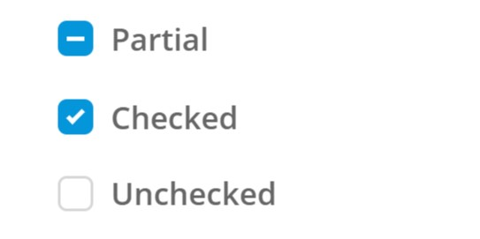
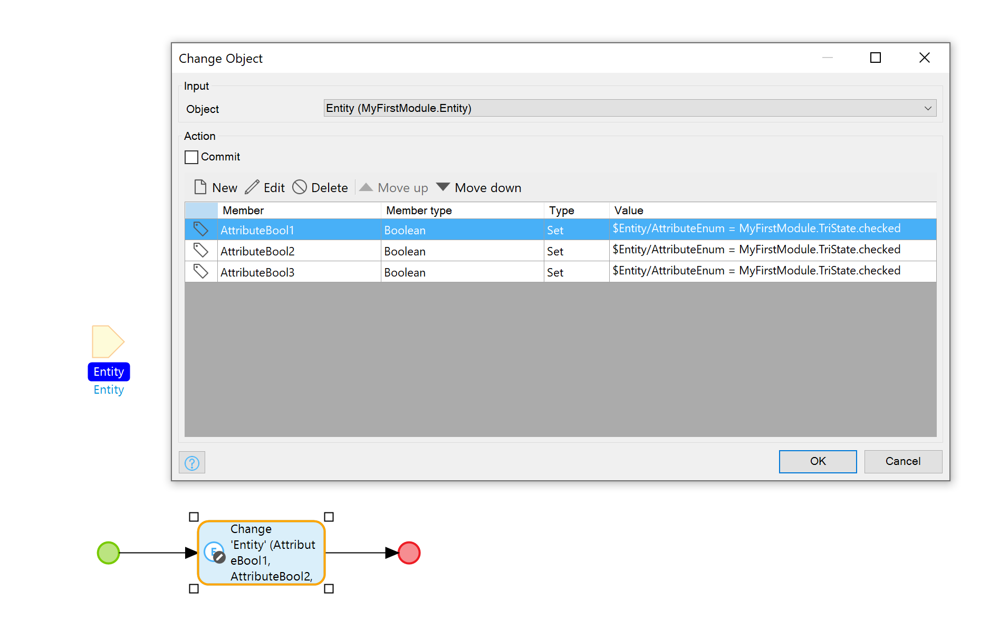
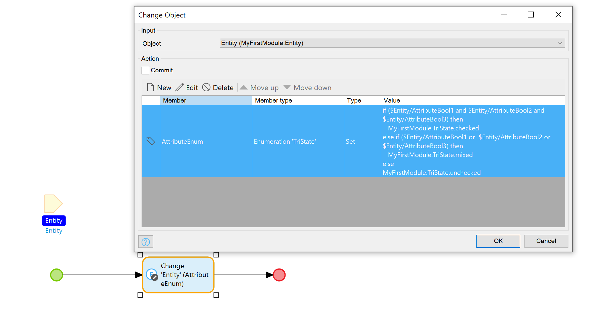
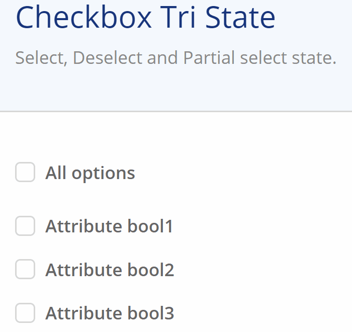

## Checkbox Tri State

Checkbox with three states; checked, unchecked and mixed.



## Features

An easy way to select and deselect a set of boolean attributes. And allowing you to indicated when only some of the underling attributes are selected.

-   CSS styled checkbox, matching the standard checkbox.
-   Intermediated or mixed state, to indicated partial selected options.
-   Click on mixed state checkbox will change the value to checked.
-   Use enumeration attribute as data source.
-   Accessible with key navigation and screen readers.
-   Click on label will update checkbox
-   Overwrite the read only state, and handle changes in a action
-   Label before and/or label after checkbox

Please note:

-   The change of the checkbox does only effect the enumeration attribute and does not automatically reflect to its dependents, it requires an `On change` action.

## Usage

-   Place the widget in a context, for example a data view or a list view
-   Create a enumeration attribute, to identify the three states; `checked`, `unchecked`, `mixed`
-   In the `Checkbox Tri State` widget;
    -   Select the enumeration attribute, the enumeration should have values with the name:
        -   For checked; "checked", "\_true" or "true".
        -   For unchecked; "unchecked", "\_false" or "false".
        -   For mixed; "mixed", "partial", "some" or "indeterminate".
    -   Add an `On change` event nanoflow to update the state of the correlated boolean attributes. Set they value to
        `$Entity/AttributeEnum = MyFirstModule.TriState.checked` for each related boolean
        
-   In the correlated boolean widgets, add an `On change` event nanoflow to update the `Checkbox Three State` widgets
    enumeration attribute.
    ```python
    if ($Entity/AttributeBool1 and $Entity/AttributeBool2 and $Entity/AttributeBool3) then
        MyFirstModule.TriState.checked
    else if ($Entity/AttributeBool1 or  $Entity/AttributeBool2 or $Entity/AttributeBool3) then
        MyFirstModule.TriState.mixed
    else
        MyFirstModule.TriState.unchecked
    ```
    

### Overwrite editability

An additional use case; Use this widget for editing an attribute inside a non editable List View with the `Overwrite`
option. This way you can still have the **Load more** functionality, and not all items are loaded in the list. In that
case you have use the `On change overwrite` action to handle the state change.

## Demo



## Development and contribution

This widget is built with
[Mendix Pluggable Widgets Tools](https://www.npmjs.com/package/@mendix/pluggable-widgets-tools) 11 and React 19, and
requires Mendix Studio Pro 11 or later.

Prerequisites: Node.js 22.18 or later and npm 8 or later.

1. Install the dependencies: `npm install`
1. Run `npm start` to watch for code changes. On every change:
    - the widget is bundled;
    - the bundle is placed in the `dist` folder in the root of the project;
    - the bundle is copied to the `deployment` and `widgets` folders of the Mendix test project in `./tests/testProject`
      (configured with `config.projectPath` in `package.json`).

Other scripts:

| Script             | Description                                                                         |
| ------------------ | ----------------------------------------------------------------------------------- |
| `npm run build`    | Development build; creates `dist/<version>/com.mansystems.web.CheckboxTriState.mpk` |
| `npm run release`  | Lints and creates a production build of the `.mpk`                                  |
| `npm run lint`     | Checks formatting (Prettier) and code (ESLint)                                      |
| `npm run lint:fix` | Fixes formatting and lint issues where possible                                     |

Project structure:

-   `src/CheckboxTriState.xml` – widget definition (properties shown in Studio Pro)
-   `src/CheckboxTriState.tsx` – widget container, maps the Mendix props to the checkbox
-   `src/components/Checkbox.tsx` – the checkbox component
-   `src/CheckboxTriState.editorPreview.tsx` – preview in the Studio Pro design mode
-   `src/CheckboxTriState.editorConfig.ts` – Studio Pro property configuration
-   `src/ui/` – widget styling
-   `typings/` – generated from the widget XML on build; do not edit

Pushing a tag builds the release and attaches the `.mpk` to the GitHub release (see
`.github/workflows/build-release.yml`).
